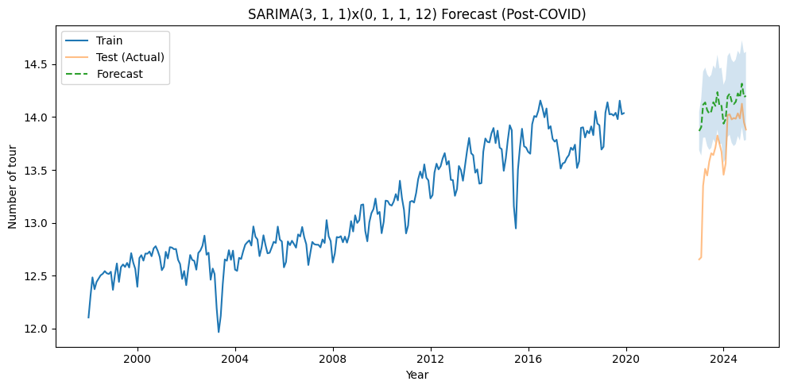
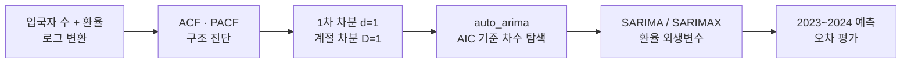
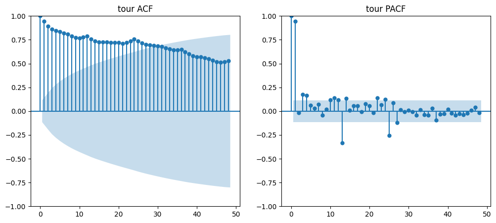
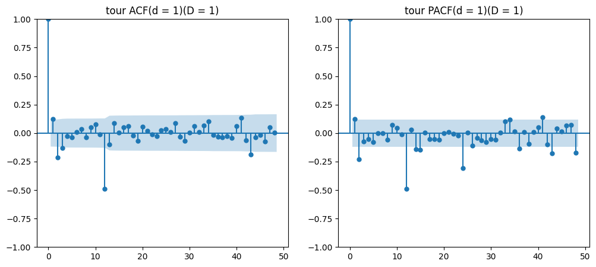
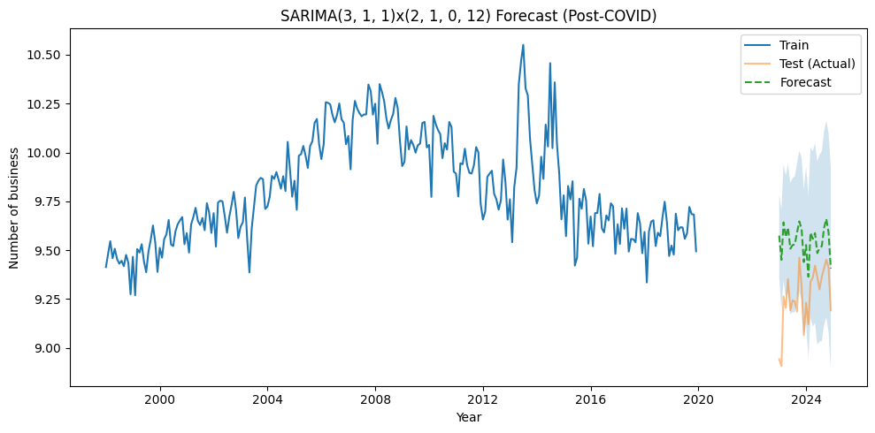
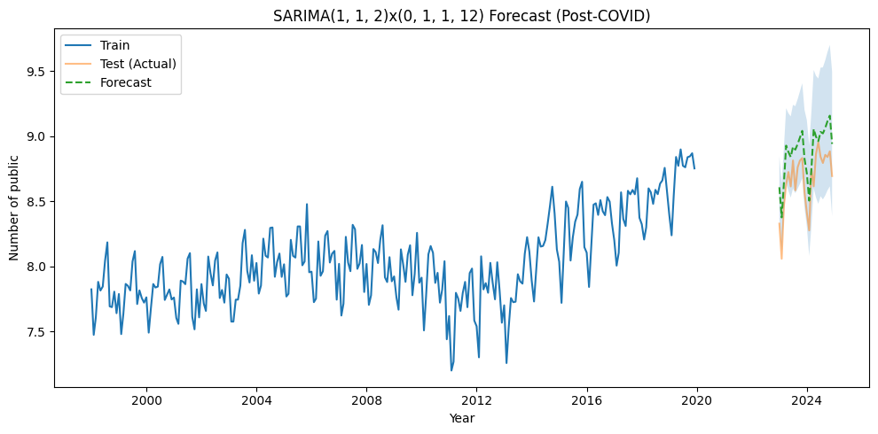
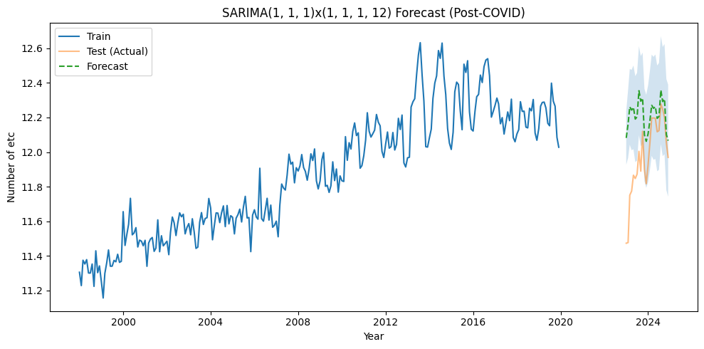

# 방한 외래객 목적별 입국자 수 SARIMA 예측

1998~2019년 목적별 방한 외래객 월별 입국자 수로 SARIMA 모델을 학습해 코로나 이후(2023~2024년) 흐름을 예측하고,
원/달러 환율이 입국자 수에 영향을 주는지 SARIMAX로 검증한 프로젝트입니다.



<sub>관광 목적 입국자 수(로그) · 파란선 학습(1998~2019), 주황선 실제(2023~2024), 초록 점선 예측과 95% 신뢰구간</sub>

## 프로젝트 정보

| 항목 | 내용 |
|---|---|
| 형태 | 4인 팀 프로젝트 |
| 본인 역할 | 시계열 구조 진단(ACF·PACF·차분), SARIMA/SARIMAX 모델링과 코로나 이후 예측, 환율 영향 분석 |
| 사용 기술 | Python, pandas, statsmodels(SARIMAX), pmdarima(auto_arima), matplotlib |

## 데이터

| 데이터 | 내용 |
|---|---|
| 목적별 방한 외래객 수 | 월별 입국자 수 · 관광 / 상용 / 공용 / 유학연수 / 기타 |
| 원/달러 환율 | 월평균 환율 (1998.01 ~ 2024.12) |

- 입국자 수와 환율 모두 **로그 변환**해 분석했습니다.
- 코로나 기간(2020~2022년)은 제외했습니다. 학습은 1998~2019년(264개월), 평가는 2023~2024년(24개월)입니다.
- 코로나 3년(36개월)을 빼고 2019년 12월 다음을 2023년 1월로 이어 붙였습니다. 36개월은 12의 배수라 월별 계절 위상은 유지됩니다.
- 저장소의 `data/inbound_by_purpose_2015_2025.csv`는 2015년 이후만 담고 있습니다. 원본 분석은 1995~2025년 파일로 진행했습니다.

## 분석 흐름



## 1. 시계열 구조 진단

| 원계열 | 1차 차분 + 계절 차분 (d=1, D=1) |
|---|---|
|  |  |

- 원계열은 ACF가 천천히 줄어드는 전형적인 비정상 시계열이었습니다(lag 1 자기상관 약 0.95).
- 1차 차분 후에도 lag 12, 24, 36에서 뚜렷한 양의 자기상관이 남아 **12개월 주기의 계절성**을 확인했습니다.
- 계절 차분까지 적용하자 대부분의 자기상관이 신뢰구간 안으로 들어와 정상성이 확보되었습니다. 다섯 개 입국 목적 모두 같은 패턴이었습니다.

## 2. 원본 분석 결과

`original/Project.ipynb`의 실행 결과입니다. 오차는 **로그 변환 값 기준**입니다.

| 입국 목적 | SARIMA 차수 | MAE | RMSE | SMAPE | 환율 계수 p-value |
|---|---|---|---|---|---|
| 관광 | (3,1,1)(0,1,1,12) | 0.43 | 0.52 | 3.12% | 0.544 |
| 상용 | (3,1,1)(2,1,0,12) | 0.28 | 0.31 | 3.01% | 0.341 |
| 공용 | (1,1,2)(0,1,1,12) | 0.22 | 0.24 | 2.49% | 0.614 |
| 기타 | (1,1,1)(1,1,1,12) | 0.24 | 0.30 | 2.00% | 0.582 |
| 유학연수 | – | – | – | – | 재실행 필요 |

<details>
<summary>목적별 예측 그래프 보기</summary>





</details>

### 해석

- **환율의 영향은 확인되지 않았습니다.** 환율을 외생변수로 넣은 모든 SARIMAX에서 환율 계수가 유의하지 않았습니다(p = 0.28 ~ 0.88). 방한 입국자 수는 환율보다 자체 계절·추세 구조로 더 잘 설명됩니다.
- **회복 초기에는 과대예측했습니다.** 2023년 초 실제 입국자 수는 코로나 이전 추세로 그린 예측보다 낮았고, 2024년에 들어서며 예측 범위에 가까워졌습니다.
- **장기 흐름은 안정·유지 단계입니다.** 관광 목적 입국자 수는 코로나 이후 회복을 거쳐 2018~2019년 고점 수준에서 완만하게 안정되는 모습을 보였습니다. 앞으로의 관광 정책은 양적 확대보다 체류의 질과 고부가가치 관광 중심으로 전환할 필요가 있다고 판단했습니다.

## 3. 원본 노트북의 한계와 수정본

원본 노트북을 다시 검토하면서 아래 문제를 발견했고, `tourism_sarima.ipynb`에서 고쳤습니다.

| 원본의 문제 | 영향 | 수정 |
|---|---|---|
| 유학연수·기타 셀에서 변수가 섞임 (셀 실행 순서 문제) | 유학연수 결과 칸에 기타 데이터 결과가 출력됨 | 5개 목적을 하나의 반복문으로 처리 |
| `auto_arima(exog=...)` 인자가 무시됨 | 차수 탐색에 환율이 반영되지 않음 | pmdarima 인자 이름 `X=` 사용 |
| 차수 탐색 모델과 최종 모델의 추정 설정이 다름 | 환율 포함 여부에 따른 AIC를 직접 비교할 수 없음 | 같은 차수·설정으로 SARIMA와 SARIMAX를 각각 적합해 비교 |
| 오차를 로그 값으로만 계산 | 실제 인원 기준 오차보다 작게 보임 | 실제 인원 기준 MAE · RMSE · MAPE 추가 |
| 코로나 더미 변수가 모두 0 | 모델에 의미 없는 변수 포함 | 코로나 기간을 명시적으로 제외하고 더미 제거 |

> 수정본 노트북의 실행 결과(유학연수 결과, 실제 인원 기준 오차, 동일 조건 AIC 비교)는 다시 실행한 뒤 이 README에 반영할 예정입니다.
> 위 표의 수치는 모두 원본 노트북 실행 결과입니다.

## 파일 구성

| 파일 | 내용 |
|---|---|
| `tourism_sarima.ipynb` | 수정본 분석 노트북 (전처리 → 구조 진단 → 차수 탐색 → SARIMA/SARIMAX → 예측·평가) |
| `original/Project.ipynb` | 실제 분석에 사용한 원본 노트북 (실행 결과 포함) |
| `data/` | 목적별 입국자 수(2015~2025), 월평균 원/달러 환율(1998~2024) |
| `assets/` | README 그래프 (원본 노트북 출력) |

## 실행 방법

[Google Colab](https://colab.research.google.com/)에서 `tourism_sarima.ipynb`를 열고, 첫 번째 코드 셀의 주석을 풀어 저장소를 받은 뒤 위에서부터 실행합니다.
결과는 `results/summary.csv`, 그래프는 `figures/`에 저장됩니다.

```bash
# 로컬에서 실행할 때
pip install -r requirements.txt
jupyter notebook tourism_sarima.ipynb
```
