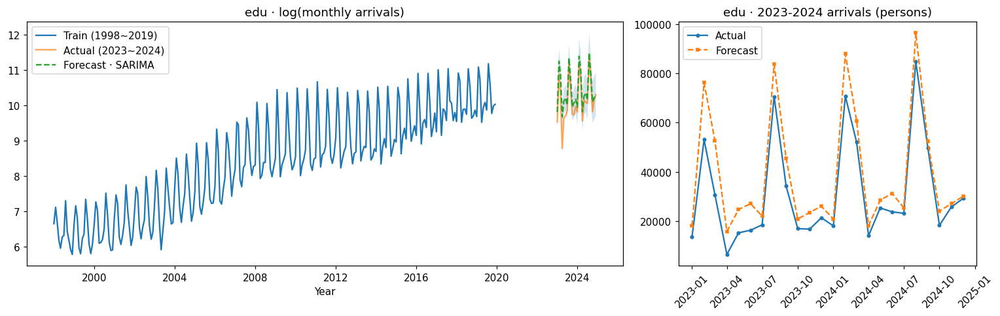

# 방한 외래객 목적별 입국자 수 SARIMA 예측

1998~2019년 목적별 방한 외래객 월별 입국자 수로 SARIMA 모델을 학습해 코로나 이후(2023~2024년) 흐름을 예측하고,
원/달러 환율이 입국자 수에 영향을 주는지 SARIMAX로 검증한 프로젝트입니다.
코로나 이전 추세로 만든 예측을 **"코로나가 없었다면"의 기준선**으로 보고, 입국 목적별 회복 정도를 비교했습니다.


<sub>왼쪽: 관광 목적 입국자 수(로그) · 학습 1998~2019, 실제 2023~2024, 예측과 95% 신뢰구간 / 오른쪽: 평가 구간을 실제 인원으로 확대</sub>

## 프로젝트 정보

| 항목 | 내용 |
|---|---|
| 형태 | 4인 팀 프로젝트 |
| 본인 역할 | 시계열 구조 진단(ACF·PACF·차분), SARIMA/SARIMAX 모델링과 코로나 이후 예측, 환율 영향 분석 |
| 사용 기술 | Python, pandas, statsmodels(SARIMAX), pmdarima(auto_arima), matplotlib |

## 핵심 결과

| | 결과 |
|---|---|
| 환율 영향 | **없음.** 같은 차수로 비교하면 환율을 넣은 SARIMAX의 AIC가 5개 목적 모두 더 높았고, 환율 계수도 유의하지 않음(p = 0.42 ~ 0.62) |
| 예측 오차 (관광) | 로그 기준 SMAPE **2.97%** · 실제 인원 기준 MAPE **58.2%** — 오차 대부분이 2023년 초 회복기에서 발생 |
| 회복 정도 | 유학연수는 2024년에 코로나 이전 추세 수준으로 회복, 관광은 여전히 추세 아래, 상용은 크게 낮은 수준에 머묾 |

## 데이터

| 데이터 | 내용 |
|---|---|
| 목적별 방한 외래객 수 | 월별 입국자 수 · 관광 / 상용 / 공용 / 유학연수 / 기타 (1995.01 ~ 2025.10) |
| 원/달러 환율 | 월평균 환율 (1998.01 ~ 2024.12) |

- 입국자 수와 환율 모두 **로그 변환**해 분석했습니다.
- 코로나 기간(2020~2022년)은 제외했습니다. 학습은 1998~2019년(264개월), 평가는 2023~2024년(24개월)입니다.
- 코로나 3년(36개월)을 빼고 2019년 12월 다음을 2023년 1월로 이어 붙였습니다. 36개월은 12의 배수라 월별 계절 위상은 유지됩니다.
- 평가 구간의 환율은 실제 관측값을 사용했습니다(사후 검증).

## 분석 흐름


## 1. 시계열 구조 진단

| 원계열 | 1차 차분 + 계절 차분 (d=1, D=1) |
|---|---|
|  |  |

- 원계열은 ACF가 천천히 줄어드는 전형적인 비정상 시계열이었습니다(lag 1 자기상관 약 0.95).
- 1차 차분 후에도 lag 12, 24, 36에서 뚜렷한 양의 자기상관이 남아 **12개월 주기의 계절성**을 확인했습니다.
- 계절 차분까지 적용하자 대부분의 자기상관이 신뢰구간 안으로 들어와 정상성이 확보되었습니다. 다섯 개 입국 목적 모두 같은 패턴이었습니다.

## 2. 모델 비교 · 예측 결과

목적별로 `auto_arima`(AIC 기준, 환율을 `X`로 전달)로 차수를 찾은 뒤, **같은 차수·같은 설정**으로 환율이 없는 SARIMA와 환율을 넣은 SARIMAX를 각각 적합했습니다.

| 입국 목적 | 차수 | AIC SARIMA | AIC SARIMAX | 환율 계수 (p) | SMAPE 로그 | MAPE 실제 인원 |
|---|---|---|---|---|---|---|
| 관광 | (1,1,2)(0,1,1,12) | **−443.5** | −442.3 | 0.186 (0.441) | 2.97% | 58.2% |
| 상용 | (1,1,3)(2,1,0,12) | **−349.6** | −348.8 | −0.237 (0.421) | 3.50% | 39.8% |
| 공용 | (1,1,2)(0,1,1,12) | **−309.5** | −307.9 | −0.125 (0.614) | 2.63% | 26.5% |
| 유학연수 | (0,1,1)(0,1,1,12) | **−148.6** | −146.8 | −0.086 (0.599) | 2.57% | 32.2% |
| 기타 | (1,1,1)(0,1,1,12) | **−526.9** | −525.1 | 0.084 (0.624) | 2.01% | 29.6% |

<sub>오차는 AIC가 더 낮은 SARIMA 기준. 전체 수치(MAE · RMSE 포함)는 `results/summary.csv`</sub>

<details>
<summary>목적별 예측 그래프 보기</summary>





</details>

### 해석

- **환율은 방한 입국자 수를 설명하지 못했습니다.** 환율을 추가해도 AIC가 나빠졌고 계수도 유의하지 않았습니다. 입국자 수는 환율보다 자체 계절·추세 구조로 더 잘 설명됩니다.
- **로그 기준 오차만 보면 정확도를 과대평가하게 됩니다.** 로그 값의 SMAPE는 2~3.5%로 작지만, 실제 인원 기준 MAPE는 27~58%였습니다. 로그 변환은 큰 차이를 작게 보이게 하므로, 해석할 때는 실제 단위의 오차를 함께 봐야 합니다.
- **예측은 코로나 이전 추세가 이어졌을 때의 기준선입니다.** 2023년 초에는 실제 입국자 수가 기준선보다 훨씬 낮았고, 이후 목적별로 회복 속도가 달랐습니다.
  - 유학연수: 2024년에는 계절 패턴까지 기준선과 거의 겹칠 만큼 회복
  - 기타: 2024년 하반기에 기준선에 근접
  - 관광: 2024년에도 기준선보다 낮은 수준에서 안정
  - 상용: 기준선보다 크게 낮은 수준에 머묾
- **시사점.** 관광 목적 입국자 수는 회복 국면을 거쳐 코로나 이전 추세보다 낮은 수준에서 안정·유지되고 있습니다. 앞으로의 관광 정책은 양적 확대보다 체류의 질과 고부가가치 관광 중심으로 전환할 필요가 있다고 판단했습니다.

### 한계와 다음 단계

- SARIMA는 코로나 같은 구조적 단절과 회복 속도를 반영하지 못합니다. 회복 구간을 설명하려면 개입(intervention) 변수나 2023년 이후 데이터를 포함한 재학습이 필요합니다.
- 평가 구간이 24개월로 짧아, 기간을 늘려 다시 검증할 필요가 있습니다.

## 3. 원본 노트북을 고친 내용

`original/Project.ipynb`(실제 분석에 쓴 원본)를 다시 검토하면서 아래 문제를 발견했고, `tourism_sarima.ipynb`에서 고친 뒤 다시 실행했습니다.

| 원본의 문제 | 영향 | 수정 |
|---|---|---|
| 유학연수·기타 셀에서 변수가 섞임 (셀 실행 순서 문제) | 유학연수 결과 칸에 기타 데이터 결과가 출력됨 | 5개 목적을 하나의 반복문으로 처리 |
| `auto_arima(exog=...)` 인자가 무시됨 | 차수 탐색에 환율이 반영되지 않음 | pmdarima 인자 이름 `X=` 사용 |
| 차수 탐색 모델과 최종 모델의 추정 설정이 다름 | 환율 포함 여부에 따른 AIC를 직접 비교할 수 없음 | 같은 차수·설정으로 SARIMA와 SARIMAX를 각각 적합해 비교 |
| 오차를 로그 값으로만 계산 | 실제 인원 기준 오차보다 훨씬 작게 보임 | 실제 인원 기준 MAE · RMSE · MAPE 추가 |
| 코로나 더미 변수가 모두 0 | 모델에 의미 없는 변수 포함 | 코로나 기간을 명시적으로 제외하고 더미 제거 |

<details>
<summary>원본 노트북의 결과 (참고)</summary>

| 입국 목적 | 차수 | SMAPE 로그 | 환율 계수 p |
|---|---|---|---|
| 관광 | (3,1,1)(0,1,1,12) | 3.12% | 0.544 |
| 상용 | (3,1,1)(2,1,0,12) | 3.01% | 0.341 |
| 공용 | (1,1,2)(0,1,1,12) | 2.49% | 0.614 |
| 기타 | (1,1,1)(1,1,1,12) | 2.00% | 0.582 |

환율이 유의하지 않다는 결론은 수정본과 같습니다. 원본에서 관광 차수가 달랐던 것은 차수 탐색에 환율이 반영되지 않았기 때문입니다.

</details>

## 파일 구성

| 파일 | 내용 |
|---|---|
| `tourism_sarima.ipynb` | 수정본 분석 노트북 (Colab 실행 결과 포함) |
| `original/Project.ipynb` | 실제 분석에 사용한 원본 노트북 (실행 결과 포함) |
| `results/summary.csv` | 목적별 · 모델별 AIC, 환율 계수, 로그 / 실제 인원 기준 오차 |
| `data/` | 목적별 입국자 수(1995~2025), 같은 데이터의 2015~2025 구간(환율·두바이유 열 포함), 월평균 원/달러 환율(1998~2024) |
| `assets/` | README 그래프 (수정본 노트북 출력) |

## 실행 방법

[Google Colab](https://colab.research.google.com/)에서 `tourism_sarima.ipynb`를 열고, "0. 환경 준비" 셀로 저장소를 받은 뒤 위에서부터 실행합니다.
결과는 `results/summary.csv`, 그래프는 `figures/`에 저장됩니다.

```bash
# 로컬에서 실행할 때 ("0. 환경 준비" 셀의 git clone · %cd 두 줄은 지우고 실행)
pip install -r requirements.txt
jupyter notebook tourism_sarima.ipynb
```
